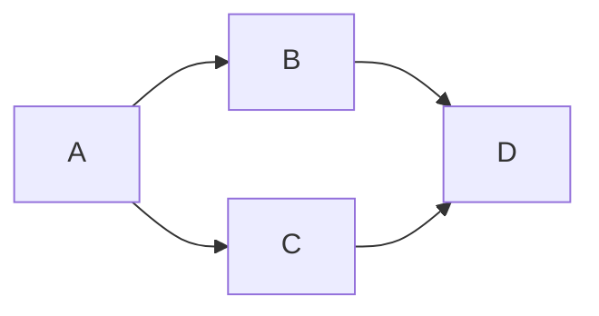
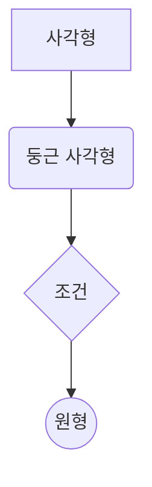

# Markdown(.md) 문법 복습 노트

Markdown은 일반 텍스트에 간단한 기호를 붙여 제목, 목록, 표, 링크, 코드 등을 표현하는 경량 마크업 언어입니다.

가장 먼저 기억할 점은 Markdown 자체의 기본 문법과 Obsidian·GitHub·Notion·Slack 같은 서비스에서 추가로 제공하는 문법은 다를 수 있다는 것입니다. 같은 `.md` 파일이라도 어떤 프로그램에서 열고 렌더링하느냐에 따라 결과가 달라질 수 있습니다.&#x20;

[image](https://www.google.com/s2/favicons?domain=https://markdown.org\&sz=32)

Markdown+1


## 1. 줄바꿈과 문단

Markdown에서 가장 헷갈리기 쉬운 부분입니다.

| 입력 방식              | 의미              |
| ------------------ | --------------- |
| Enter 한 번          | 일반적으로 같은 문단의 연속 |
| 빈 줄 하나를 넣기         | 새 문단            |
| 줄 끝 공백 두 칸 + Enter | 같은 문단 안에서 줄바꿈   |
| `<br>`             | HTML 줄바꿈 태그     |

① 문단과 문단 사이 줄바꿈

```
첫 번째 문단입니다.

두 번째 문단입니다.
```

결과: 두 개의 별도 문단으로 표시됩니다.

② 같은 문단 안에서 줄바꿈

```
첫 번째 줄입니다.  
두 번째 줄입니다.
```

첫 번째 줄 끝에 공백을 두 칸 넣고 Enter를 누릅니다.

또는 HTML 태그를 사용할 수 있습니다.

```
첫 번째 줄입니다.<br>
두 번째 줄입니다.
```

③ Enter 한 번만 누르면?

```
첫 번째 줄입니다.
두 번째 줄입니다.
```

일반적인 Markdown에서는 하나의 문단으로 이어집니다. 다만 Obsidian은 `Shift + Enter`로 같은 문단 안에 줄바꿈을 넣을 수 있으며, 설정에 따라 동작이 달라질 수 있습니다.&#x20;

[image](https://www.google.com/s2/favicons?domain=https://obsidian.md\&sz=32)

Obsidian Help+1


암기 포인트

&#x20;문단 구분은 빈 줄, 문단 안 줄바꿈은 공백 두 칸 + Enter 또는 `<br>`입니다.


## 2. 제목(Heading)

`#` 기호의 개수로 제목의 단계가 결정됩니다. `#` 뒤에는 반드시 공백을 넣는 것이 기본 규칙입니다.

```
# 제목 1

## 제목 2

### 제목 3

#### 제목 4

##### 제목 5

###### 제목 6
```

| 문법           | 의미           |
| ------------ | ------------ |
| `# 제목`       | 제목 1단계       |
| `## 제목`      | 제목 2단계       |
| `### 제목`     | 제목 3단계       |
| `###### 제목`  | 제목 6단계       |
| `####### 제목` | 표준 제목 단계가 아님 |

제목은 굵게 보이기도 하지만, `**`로 진하게 만드는 것과는 다른 기능입니다. 제목은 문서의 구조를 만드는 역할을 합니다.

공백 유무에 따른 차이

```
# 제목
#제목
```

첫 번째는 제목이고, 두 번째는 일반 텍스트로 처리됩니다. 단, Obsidian에서는 `#태그`처럼 `#` 뒤에 공백 없이 입력하면 태그로 인식할 수 있습니다.

- `# 제목` → Markdown 제목
- `#태그` → Obsidian 등의 태그 문법
- `#123` → GitHub에서 이슈나 PR 번호를 참조하는 문맥으로 사용 가능

즉, `#` 하나가 모든 프로그램에서 같은 의미를 갖는 것은 아닙니다.

참고: 밑줄을 이용한 제목

```
큰 제목
=======

작은 제목
---------
```

일부 Markdown 표준에서 지원하는 다른 제목 작성법입니다. 일반적으로는 `#`을 이용하는 방식을 권장합니다.&#x20;

[image](https://www.google.com/s2/favicons?domain=https://spec.commonmark.org\&sz=32)

CommonMark 사양+1


## 3. 구분선(Horizontal Rule)

세 개 이상의 하이픈, 별표, 밑줄을 한 줄에 입력하면 구분선이 됩니다.

```
---

***

___
```

참고: `---`는 앞 문장과의 배치에 따라 제목 2단계로 해석될 수도 있으므로, 구분선으로 사용할 때는 앞에 빈 줄을 넣는 것이 안전합니다.

구분선은 제목 단계가 아니라 내용 영역을 시각적으로 나누는 선입니다.

## 4. 목록(List)

목록은 크게 순서가 없는 목록과 순서가 있는 목록으로 나뉩니다.

### 4-1. 순서 없는 목록(Unordered List)

`-`, `*`, `+` 중 하나를 사용합니다. 기호 다음에는 반드시 공백을 넣습니다.

```
- 피자
- 커피
- 치즈
```

또는

```
* 피자
* 커피
* 치즈
```

또는

```
+ 피자
+ 커피
+ 치즈
```

세 가지 모두 같은 종류의 목록을 만듭니다.

실무에서는 보통 하이픈(-)을 가장 많이 사용합니다.

### 4-2. 중첩 목록(Nested List)

들여쓰기를 사용하면 하위 목록을 만들 수 있습니다.

```
- 내가 좋아하는 음식
  - 피자
  - 파스타
  - 치즈
    - 모차렐라
    - 체다

- 내가 좋아하는 음료
  - 커피
  - 차
```

결과:

- 내가 좋아하는 음식
  - 피자
  - 파스타
  - 치즈
    - 모차렐라
    - 체다
- 내가 좋아하는 음료
  - 커피
  - 차

들여쓰기 방법

- 스페이스 2\~4칸을 이용합니다.
- Tab으로 들여쓰기할 수도 있습니다.
- 프로그램마다 들여쓰기 해석에 차이가 있으므로 공백을 일정하게 사용하는 편이 좋습니다.

### 4-3. 순서 있는 목록(Ordered List)

숫자 뒤에 마침표와 공백을 붙입니다.

```
1. 리센느 - with
2. 리센느 - 백화요란
3. 리센느 - Glow
4. 리센느 - Love Attack
```

중요한 특징은 입력한 숫자와 화면에 표시되는 숫자가 항상 같지는 않다는 것입니다.

```
1. 첫 번째
1. 두 번째
1. 세 번째
```

일반적인 Markdown 렌더러는 다음과 같이 자동으로 번호를 매깁니다.

1. 첫 번째
2. 두 번째
3. 세 번째

다음과 같이 입력해도 마찬가지입니다.

```
1. 첫 번째
4. 두 번째
11. 세 번째
3. 네 번째
```

렌더링 결과:

1. 첫 번째
2. 두 번째
3. 세 번째
4. 네 번째

첫 번호가 시작 번호를 결정하고, 뒤의 항목은 순서에 따라 이어지는 것이 일반적입니다.

### 4-4. 체크박스(Task List)

할 일의 완료 여부를 표시하는 문법입니다.

```
- [ ] Markdown 복습하기
- [ ] Python 실습하기
- [x] SQL 과제 완료하기
```

결과:

- Markdown 복습하기
- Python 실습하기
- SQL 과제 완료하기

| 입력      | 의미  |
| ------- | --- |
| `- [ ]` | 미완료 |
| `- [x]` | 완료  |
| `- [X]` | 완료  |

이 문법은 GitHub의 Issue, Pull Request, README 등에서 작업 진행 상황을 정리하는 데 유용합니다. GitHub와 Obsidian에서 지원하지만 모든 Markdown 프로그램에서 작동하는 것은 아닙니다.&#x20;

[image](https://www.google.com/s2/favicons?domain=https://docs.github.com\&sz=32)

GitHub Docs+1


### 4-5. 순서 목록과 체크박스 결합

```
1. [x] 데이터 수집
2. [x] 데이터 전처리
3. [ ] 데이터 시각화
4. [ ] 분석 결과 작성
```

작업 순서와 진행 상태를 동시에 표현할 수 있습니다.

## 5. 글자 꾸미기(Text Formatting)

### 5-1. 기울임(Italic)

별표 하나 또는 밑줄 하나로 감쌉니다.

```
*기울이기*

_기울이기_
```

결과: 기울이기

### 5-2. 굵게(Bold)

별표 두 개 또는 밑줄 두 개를 사용합니다.

```
**진하게**

__진하게__
```

결과: 진하게

### 5-3. 굵게 + 기울임(Bold + Italic)

별표 세 개를 사용하거나, 굵게와 기울임을 중첩합니다.

```
***굵게 + 기울임***

**_굵게 + 기울임_**
```

결과: 굵게 + 기울임

### 5-4. 취소선(Strikethrough)

물결표(\~) 두 개를 앞뒤로 붙입니다.

```
~~취소된 내용~~
```

결과: 취소된 내용

### 5-5. 형광펜(Highlight)

Obsidian에서는 등호 두 개를 이용합니다.

```
==중요한 내용==
```

결과: ==중요한 내용==

HTML 방식도 있습니다.

```
<mark>중요한 내용</mark>
```

결과:&#x20;

다만 `==텍스트==`는 Obsidian 등의 확장 문법이며 모든 Markdown에서 지원하지 않습니다.&#x20;

[image](https://www.google.com/s2/favicons?domain=https://obsidian.md\&sz=32)

Obsidian Help+1


### 5-6. 왜 별표가 목록이 되거나 기울임이 될까?

별표는 위치와 공백에 따라 기능이 달라집니다.

| 작성법        | 기능          |
| ---------- | ----------- |
| `* 항목`     | 순서 없는 목록    |
| `*기울임*`    | 기울임         |
| `**굵게**`   | 굵게          |
| `***강조***` | 굵게 + 기울임    |
| `\*`       | 별표 기호 자체 출력 |

예를 들어 다음 둘은 다릅니다.

```
* 내가 원한 건 말머리표

*내가 원한 건 기울임*
```

첫 번째는 목록이고 두 번째는 기울임입니다.

핵심: 목록은 기호 뒤에 공백을 넣고, 글자 꾸미기는 앞뒤에 기호를 붙입니다.

## 6. 코드(Code)

코드는 크게 인라인 코드와 코드 블록으로 구분합니다.

### 6-1. 인라인 코드(Inline Code)

백틱(Backtick) 하나로 감쌉니다.

키보드에서 숫자 1 왼쪽에 있는 `` ` `` 기호입니다.

```
Python의 `print()` 함수를 사용합니다.
```

결과:

Python의 `print()` 함수를 사용합니다.

코드나 명령어를 문장 속에서 강조할 때 사용합니다.

예시:

- `SELECT * FROM employees`
- `df.head()`
- `np.argmax()`
- `Ctrl + /`

### 6-2. 코드 블록(Code Block)

백틱 세 개를 위아래에 입력합니다.

````
```
print("Hello World")
12345678
```
````

결과:

```
print("Hello World")
12345678
```

### 6-3. 언어 지정(Syntax Highlighting)

코드 블록 시작 부분의 백틱 뒤에 언어 이름을 지정합니다.

````
```python
print("Hello World")
```
````

결과:

```
print("Hello World")
```

주요 언어 지정 예시:

| 언어         | 지정 문자열       |
| ---------- | ------------ |
| Python     | `python`     |
| SQL        | `sql`        |
| JavaScript | `javascript` |
| HTML       | `html`       |
| CSS        | `css`        |
| JSON       | `json`       |
| Bash       | `bash`       |
| R          | `r`          |
| Mermaid    | `mermaid`    |
| 일반 텍스트     | `text`       |

### 6-4. 백틱이 코드 안에 포함되어 있다면?

백틱 세 개를 보여 주거나 코드 내부에 백틱을 포함하려면 바깥쪽 백틱 개수를 늘릴 수 있습니다.

예를 들어 백틱 세 개가 들어 있는 코드를 표시하려면 바깥을 백틱 네 개로 감쌉니다.

주의: 코드 블록 안의 Markdown은 명령으로 실행되지 않고 작성한 문자 그대로 표시됩니다.

## 7. 인용문(Blockquote)

`>` 기호를 사용합니다.

```
> 첫 번째 인용문입니다.
```

결과:

> 첫 번째 인용문입니다.

### 중첩 인용

```
> 첫 번째 인용
>> 두 번째 인용
>>> 세 번째 인용
```

결과:

> 첫 번째 인용
>
> > 두 번째 인용
> >
> > > 세 번째 인용

### 인용문 안에 코드나 목록 넣기

```
> 프로그래밍 공부를 시작합시다.
>
> - Python
> - SQL
> - Tableau
>
> `print("Hello")`
```

결과:

> 프로그래밍 공부를 시작합시다.
>
> - Python
> - SQL
> - Tableau
>
> `print("Hello")`

인용문은 다른 사람의 말을 인용하거나 참고사항, 주의사항을 구분할 때 유용합니다.

## 8. 주석(Comment)과 이스케이프(Escape)

### 8-1. HTML 주석

```
<!-- 이 내용은 렌더링 화면에 표시되지 않습니다. -->
```

Markdown을 렌더링한 화면에서는 주석 내용이 보이지 않지만, 원본 `.md` 파일에서는 확인할 수 있습니다.

주석은 작성 메모, 임시 설명, 코드 작성자 간 참고사항 등에 활용합니다.

Obsidian 전용 주석

```
%% Obsidian에서 숨겨지는 주석 %%
```

Obsidian은 `%%` 문법도 지원합니다. 다른 프로그램에서는 동작하지 않을 수 있습니다.&#x20;

[image](https://www.google.com/s2/favicons?domain=https://obsidian.md\&sz=32)

Obsidian Help+1


### 8-2. 이스케이프 문자(Escape Character)

Markdown이 특별한 기능으로 인식하는 기호를 일반 문자로 표시하고 싶을 때 사용합니다.

역슬래시 `\`를 기호 앞에 붙입니다.

```
\* 별표 기호 자체를 표시

\# 제목 기호 자체를 표시

\+ 플러스 기호 자체를 표시

\~ 물결표 자체를 표시
```

| 입력    | 결과 |
| ----- | -- |
| `\*`  | \* |
| `\#`  | #  |
| `\+`  | +  |
| `\~`  | \~ |
| `\\|` | \| |
| `\[`  | [  |
| `\]`  | ]  |
| `\(`  | (  |
| `\)`  | )  |
| `\_`  | \_ |

자주 사용하는 상황

- 별표가 목록이나 기울임으로 변하는 것을 방지
- `#`이 제목으로 인식되는 것을 방지
- 표 안에서 `|`를 일반 문자로 표시
- Markdown 문법 자체를 설명할 때 활용

### 8-3. Ctrl + /

`Ctrl + /`는 Markdown 문법이 아니라 편집기에서 제공하는 단축키입니다.

일반적으로 선택한 텍스트를 주석 처리하거나 주석을 해제하는 기능으로 사용될 수 있지만, 프로그램마다 기능과 단축키가 다릅니다.

## 9. 링크(Link)

대괄호와 소괄호를 조합합니다.

기본 형태:

```
[표시할 문자](URL)
```

실제 작성:

```
[네이버 바로가기](https://naver.com)
```

결과: [네이버 바로가기](https://naver.com?utm_source=chatgpt.com)

구성 요소

| 기호         | 역할         |
| ---------- | ---------- |
| `[ ]`      | 화면에 표시할 글자 |
| `( )`      | 실제 접속할 URL |
| `https://` | 웹 주소의 프로토콜 |

기존 메모의 다음 문법은 수정해야 합니다.

```
[연결하고 싶은 문자]([https://naver.com](https://naver.com))
```

올바른 문법은 다음입니다.

```
[연결하고 싶은 문자](https://naver.com)
```

### 9-1. URL 자체를 표시하기

```
<https://naver.com>
```

또는 프로그램에 따라 URL을 그대로 입력해도 자동으로 링크가 만들어집니다.

### 9-2. 참조형 링크(Reference Link)

링크가 여러 번 등장할 때 유용합니다.

```
[네이버][naver]
[네이버 홈페이지][naver]

[naver]: https://naver.com
```

링크 주소를 마지막에 한 번 정의해서 재사용합니다.

### 9-3. 내부 문서 링크

Obsidian에서는 다음과 같은 문법도 활용합니다.

```
[[Python 기초]]
[[SQL 실습]]
[[Tableau 프로젝트]]
```

이것은 일반 Markdown의 기본 문법이 아닌 Obsidian의 Wikilink 기능입니다.

## 10. 이미지(Image)

느낌표 `!`와 링크 문법을 조합합니다.

기본 형태:

```

```

실제 예시:

```

```

결과:

[Imágenes de Paisaje Panorámico | Descarga imágenes gratuitas en Unsplash](https://images.openai.com/static-rsc-4/4pQVCBlHX168QNkr5ruQuACBBTQc4frUxvwRkPN73uGQORhzAFRsxY-Ej9AQ5lGe39Y9Hb9MtIp0in4aII1MKlbZOGtf3MbTnm5omjWV1u8SFDzsQnPh2D18qKIftABODnPr05d_FGkhc7Pwr6Z97lMSql85swrf6ftKUM_Kstc?purpose=inline)

[unsplash.com](https://unsplash.com/es/s/fotos/paisaje-panor%C3%A1mico?utm_source=chatgpt.com)

### 10-1. 이미지 문법 구성

| 기호    | 역할                   |
| ----- | -------------------- |
| `!`   | 이미지 삽입을 의미           |
| `[ ]` | 이미지 대체 텍스트(Alt Text) |
| `( )` | 이미지 주소               |

대체 텍스트는 이미지가 로드되지 않거나 스크린 리더를 사용하는 상황에서 이미지의 내용을 설명하는 역할을 합니다.

### 10-2. 일반 링크와 이미지 비교

```
[네이버](https://naver.com)


```

- `[ ]( )` → 클릭 가능한 링크
- `` → 이미지 표시

### 10-3. 이미지를 클릭하면 다른 사이트로 이동

이미지 문법을 링크 문법 안에 넣으면 됩니다.

```
[](접속할URL)
```

구조를 이해하면 다음과 같습니다.

바깥쪽 링크 `[ ]( )`

이미지를 클릭했을 때 이동할 주소

안쪽 이미지 ``

화면에 표시할 이미지의 주소와 대체 텍스트

### 10-4. 로컬 이미지

인터넷 주소뿐 아니라 파일 경로를 사용할 수도 있습니다.

```

```

이때 이미지 파일도 Markdown 파일과 함께 전달해야 합니다. 상대 경로가 실제 파일 위치와 맞아야 이미지가 표시됩니다.

## 11. 표(Table)

세로선 `|`과 하이픈 `-`을 이용합니다.

세로선은 일반적으로 \*\*파이프(Pipe)\*\*라고 부릅니다. 파이프라인(Pipeline)과는 다른 용어입니다.

### 11-1. 기본 표

```
| 제목1 | 제목2 |
| --- | --- |
| 내용1 | 내용2 |
```

결과:

| 제목1 | 제목2 |
| --- | --- |
| 내용1 | 내용2 |

표의 첫 번째 줄은 제목(Header), 두 번째 줄은 구분선, 그다음부터는 내용(Data)입니다.

### 11-2. 3개 이상의 열 만들기

```
| 이름 | 나이 | 직업 |
| --- | --- | --- |
| 철수 | 25 | 학생 |
| 영희 | 30 | 개발자 |
```

결과:

| 이름 | 나이 | 직업  |
| -- | -- | --- |
| 철수 | 25 | 학생  |
| 영희 | 30 | 개발자 |

열의 개수는 `|`로 구분합니다.

### 11-3. 한 개의 열만 있는 표

기존 메모에서 보강해야 하는 부분입니다.

```
| 제목 |
| --- |
| 내용 |
```

결과:

| 제목 |
| -- |
| 내용 |

구분선에는 하이픈이 최소 3개 있어야 하는 것이 GitHub 표 문법의 규칙입니다.

따라서 다음은 피해야 합니다.

```
| 제목 |
| - |
| 내용 |
```

### 11-4. 정렬(Alignment)

표 구분선에 콜론 `:`을 넣어 정렬 방식을 지정합니다.

| 문법      | 정렬     |
| ------- | ------ |
| `:---`  | 왼쪽 정렬  |
| `---:`  | 오른쪽 정렬 |
| `:---:` | 가운데 정렬 |

실제 예시:

```
| 왼쪽 | 가운데 | 오른쪽 |
| :--- | :---: | ---: |
| 사과 | 바나나 | 1000 |
| 포도 | 딸기 | 2000 |
```

결과:

| 왼쪽 | 가운데 | 오른쪽  |
| -- | --- | ---- |
| 사과 | 바나나 | 1000 |
| 포도 | 딸기  | 2000 |

### 11-5. 표 안에 파이프 기호를 입력하려면?

파이프는 열을 구분하기 때문에 일반 문자로 사용하려면 이스케이프해야 합니다.

```
| 연산자 | 의미 |
| --- | --- |
| `\|` | 파이프 기호 |
```

결과:

| 연산자   | 의미     |
| ----- | ------ |
| `\\|` | 파이프 기호 |

GitHub와 Obsidian의 표 기능은 제목 행, 열 구분, 정렬 등을 지원합니다. 다만 표의 세부 기능은 사용하는 Markdown 확장에 따라 달라질 수 있습니다.&#x20;

[image](https://www.google.com/s2/favicons?domain=https://docs.github.com\&sz=32)

GitHub Docs+1


## 12. HTML 태그 활용

Markdown만으로 표현하기 어려운 부분은 HTML을 함께 사용할 수 있습니다.

| HTML 태그    | 기능       | 예시                    |
| ---------- | -------- | --------------------- |
| `<br>`     | 줄바꿈      | `A<br>B`              |
| `<b>`      | 굵게       | `<b>강조</b>`           |
| `<strong>` | 중요 내용 강조 | `<strong>중요</strong>` |
| `<i>`      | 기울임      | `<i>기울임</i>`          |
| `<u>`      | 밑줄       | `<u>밑줄</u>`           |
| `<mark>`   | 형광펜      | `<mark>강조</mark>`     |
| `<sub>`    | 아래 첨자    | `H<sub>2</sub>O`      |
| `<sup>`    | 위 첨자     | `x<sup>2</sup>`       |

### 12-1. 가운데 정렬

기존에 적어 둔 문법:

```
<center>가운데 정렬</center>
```

일부 HTML 렌더러에서는 동작하지만, `<center>`는 오래된 표현이므로 권장하지 않습니다.

일반적인 HTML에서는 다음처럼 작성할 수 있습니다.

```
<div style="text-align: center;">
가운데 정렬
</div>
```

다만 GitHub 등에서는 보안상 HTML이나 CSS의 일부 속성을 제한할 수 있습니다.

### 12-2. 공백 유지

```
&nbsp;
```

`&nbsp;`는 줄바꿈이 일어나지 않는 공백(Non-breaking space)을 의미합니다.

일반 공백과 달리 단어 사이의 공백이 줄바꿈으로 끊기지 않도록 할 때 활용합니다.

### 12-3. HTML과 Markdown의 관계

Markdown은 HTML을 함께 사용할 수 있도록 설계되어 있습니다.

하지만 다음을 기억해야 합니다.

- Markdown 기본 문법이 아닌 HTML 기능도 있다.
- HTML 태그를 모두 허용하는 것은 아니다.
- 플랫폼에 따라 CSS, 정렬, 크기 조절 등이 제한될 수 있다.
- 보안상 특정 태그나 속성이 제거되기도 한다.

## 13. Mermaid: 다이어그램 그리기

Mermaid는 Markdown 코드 블록을 이용하여 흐름도, 시퀀스 다이어그램, 간트 차트 등을 그리는 도구입니다.

일반 코드 블록과 달리 `mermaid`라는 언어를 지정합니다.

### 13-1. 기본 흐름도(Flowchart)

````

````

결과:

\#chatgpt-mermaid-\_r_lg\_{font-family:-apple-system-body,ui-sans-serif,-apple-system,system-ui,"Segoe UI",Helvetica,"Apple Color Emoji",Arial,sans-serif,"Segoe UI Emoji","Segoe UI Symbol";font-size:16px;fill:rgb(13, 13, 13);}@keyframes edge-animation-frame{from{stroke-dashoffset:0;}}@keyframes dash{to{stroke-dashoffset:0;}}#chatgpt-mermaid-\_r_lg\_ .edge-animation-slow{stroke-dasharray:9,5!important;stroke-dashoffset:900;animation:dash 50s linear infinite;stroke-linecap:round;}#chatgpt-mermaid-\_r_lg\_ .edge-animation-fast{stroke-dasharray:9,5!important;stroke-dashoffset:900;animation:dash 20s linear infinite;stroke-linecap:round;}#chatgpt-mermaid-\_r_lg\_ .error-icon{fill:rgb(243, 243, 243);}#chatgpt-mermaid-\_r_lg\_ .error-text{fill:rgb(13, 13, 13);stroke:rgb(13, 13, 13);}#chatgpt-mermaid-\_r_lg\_ .edge-thickness-normal{stroke-width:1px;}#chatgpt-mermaid-\_r_lg\_ .edge-thickness-thick{stroke-width:3.5px;}#chatgpt-mermaid-\_r_lg\_ .edge-pattern-solid{stroke-dasharray:0;}#chatgpt-mermaid-\_r_lg\_ .edge-thickness-invisible{stroke-width:0;fill:none;}#chatgpt-mermaid-\_r_lg\_ .edge-pattern-dashed{stroke-dasharray:3;}#chatgpt-mermaid-\_r_lg\_ .edge-pattern-dotted{stroke-dasharray:2;}#chatgpt-mermaid-\_r_lg\_ .marker{fill:rgb(143, 143, 143);stroke:rgb(143, 143, 143);}#chatgpt-mermaid-\_r_lg\_ .marker.cross{stroke:rgb(143, 143, 143);}#chatgpt-mermaid-\_r_lg\_ svg{font-family:-apple-system-body,ui-sans-serif,-apple-system,system-ui,"Segoe UI",Helvetica,"Apple Color Emoji",Arial,sans-serif,"Segoe UI Emoji","Segoe UI Symbol";font-size:16px;}#chatgpt-mermaid-\_r_lg\_ p{margin:0;}#chatgpt-mermaid-\_r_lg\_ .label{font-family:-apple-system-body,ui-sans-serif,-apple-system,system-ui,"Segoe UI",Helvetica,"Apple Color Emoji",Arial,sans-serif,"Segoe UI Emoji","Segoe UI Symbol";color:rgb(13, 13, 13);}#chatgpt-mermaid-\_r_lg\_ .cluster-label text{fill:rgb(13, 13, 13);}#chatgpt-mermaid-\_r_lg\_ .cluster-label span{color:rgb(13, 13, 13);}#chatgpt-mermaid-\_r_lg\_ .cluster-label span p{background-color:transparent;}#chatgpt-mermaid-\_r_lg\_ .label text,#chatgpt-mermaid-\_r_lg\_ span{fill:rgb(13, 13, 13);color:rgb(13, 13, 13);}#chatgpt-mermaid-\_r_lg\_ .node rect,#chatgpt-mermaid-\_r_lg\_ .node circle,#chatgpt-mermaid-\_r_lg\_ .node ellipse,#chatgpt-mermaid-\_r_lg\_ .node polygon,#chatgpt-mermaid-\_r_lg\_ .node path{fill:rgb(222, 234, 251);stroke:rgb(83, 154, 248);stroke-width:1px;}#chatgpt-mermaid-\_r_lg\_ .rough-node .label text,#chatgpt-mermaid-\_r_lg\_ .node .label text,#chatgpt-mermaid-\_r_lg\_ .image-shape .label,#chatgpt-mermaid-\_r_lg\_ .icon-shape .label{text-anchor:middle;}#chatgpt-mermaid-\_r_lg\_ .node .katex path{fill:#000;stroke:#000;stroke-width:1px;}#chatgpt-mermaid-\_r_lg\_ .rough-node .label,#chatgpt-mermaid-\_r_lg\_ .node .label,#chatgpt-mermaid-\_r_lg\_ .image-shape .label,#chatgpt-mermaid-\_r_lg\_ .icon-shape .label{text-align:center;}#chatgpt-mermaid-\_r_lg\_ .node.clickable{cursor:pointer;}#chatgpt-mermaid-\_r_lg\_ .root .anchor path{fill:rgb(143, 143, 143)!important;stroke-width:0;stroke:rgb(143, 143, 143);}#chatgpt-mermaid-\_r_lg\_ .arrowheadPath{fill:rgb(143, 143, 143);}#chatgpt-mermaid-\_r_lg\_ .edgePath .path{stroke:rgb(143, 143, 143);stroke-width:1px;}#chatgpt-mermaid-\_r_lg\_ .flowchart-link{stroke:rgb(143, 143, 143);fill:none;}#chatgpt-mermaid-\_r_lg\_ .edgeLabel{background-color:rgb(252, 252, 252);text-align:center;}#chatgpt-mermaid-\_r_lg\_ .edgeLabel p{background-color:rgb(252, 252, 252);}#chatgpt-mermaid-\_r_lg\_ .edgeLabel rect{opacity:0.5;background-color:rgb(252, 252, 252);fill:rgb(252, 252, 252);}#chatgpt-mermaid-\_r_lg\_ .labelBkg{background-color:rgba(252, 252, 252, 0.5);}#chatgpt-mermaid-\_r_lg\_ .cluster rect{fill:rgb(243, 243, 243);stroke:rgba(0, 0, 0, 0.1);stroke-width:1px;}#chatgpt-mermaid-\_r_lg\_ .cluster text{fill:rgb(13, 13, 13);}#chatgpt-mermaid-\_r_lg\_ .cluster span{color:rgb(13, 13, 13);}#chatgpt-mermaid-\_r_lg\_ div.mermaidTooltip{position:absolute;text-align:center;max-width:200px;padding:2px;font-family:-apple-system-body,ui-sans-serif,-apple-system,system-ui,"Segoe UI",Helvetica,"Apple Color Emoji",Arial,sans-serif,"Segoe UI Emoji","Segoe UI Symbol";font-size:12px;background:rgb(243, 243, 243);border:1px solid rgba(0, 0, 0, 0.1);border-radius:2px;pointer-events:none;z-index:100;}#chatgpt-mermaid-\_r_lg\_ .flowchartTitleText{text-anchor:middle;font-size:18px;fill:rgb(13, 13, 13);}#chatgpt-mermaid-\_r_lg\_ rect.text{fill:none;stroke-width:0;}#chatgpt-mermaid-\_r_lg\_ .icon-shape,#chatgpt-mermaid-\_r_lg\_ .image-shape{background-color:rgb(252, 252, 252);text-align:center;}#chatgpt-mermaid-\_r_lg\_ .icon-shape p,#chatgpt-mermaid-\_r_lg\_ .image-shape p{background-color:rgb(252, 252, 252);padding:2px;}#chatgpt-mermaid-\_r_lg\_ .icon-shape .label rect,#chatgpt-mermaid-\_r_lg\_ .image-shape .label rect{opacity:0.5;background-color:rgb(252, 252, 252);fill:rgb(252, 252, 252);}#chatgpt-mermaid-\_r_lg\_ .label-icon{display:inline-block;height:1em;overflow:visible;vertical-align:-0.125em;}#chatgpt-mermaid-\_r_lg\_ .node .label-icon path{fill:currentColor;stroke:revert;stroke-width:revert;}#chatgpt-mermaid-\_r_lg\_ .node .neo-node{stroke:rgb(83, 154, 248);}#chatgpt-mermaid-\_r_lg\_ [data-look="neo"].node rect,#chatgpt-mermaid-\_r_lg\_ [data-look="neo"].cluster rect,#chatgpt-mermaid-\_r_lg\_ [data-look="neo"].node polygon{stroke:url(#chatgpt-mermaid-\_r_lg\_-gradient);filter:drop-shadow( 1px 2px 2px rgba(185,185,185,1));}#chatgpt-mermaid-\_r_lg\_ [data-look="neo"].swimlane.cluster rect{filter:none;}#chatgpt-mermaid-\_r_lg\_ [data-look="neo"].node path{stroke:url(#chatgpt-mermaid-\_r_lg\_-gradient);stroke-width:1px;}#chatgpt-mermaid-\_r_lg\_ [data-look="neo"].node .outer-path{filter:drop-shadow( 1px 2px 2px rgba(185,185,185,1));}#chatgpt-mermaid-\_r_lg\_ [data-look="neo"].node .neo-line path{stroke:rgb(83, 154, 248);filter:none;}#chatgpt-mermaid-\_r_lg\_ [data-look="neo"].node circle{stroke:url(#chatgpt-mermaid-\_r_lg\_-gradient);filter:drop-shadow( 1px 2px 2px rgba(185,185,185,1));}#chatgpt-mermaid-\_r_lg\_ [data-look="neo"].node circle .state-start{fill:#000000;}#chatgpt-mermaid-\_r_lg\_ [data-look="neo"].icon-shape .icon{fill:url(#chatgpt-mermaid-\_r_lg\_-gradient);filter:drop-shadow( 1px 2px 2px rgba(185,185,185,1));}#chatgpt-mermaid-\_r_lg\_ [data-look="neo"].icon-shape .icon-neo path{stroke:url(#chatgpt-mermaid-\_r_lg\_-gradient);filter:drop-shadow( 1px 2px 2px rgba(185,185,185,1));}#chatgpt-mermaid-\_r_lg\_ .node text{font-size:14px;font-weight:600;letter-spacing:normal;fill:rgb(0, 79, 153);}#chatgpt-mermaid-\_r_lg\_ .edgeLabels text{font-size:13px;font-weight:600;letter-spacing:-0.08px;fill:rgb(0, 79, 153);}#chatgpt-mermaid-\_r_lg\_ .node tspan[font-weight="normal"],#chatgpt-mermaid-\_r_lg\_ .edgeLabels tspan[font-weight="normal"]{font-weight:600;}#chatgpt-mermaid-\_r_lg\_ .edgeLabel .label rect{opacity:1;rx:13px;ry:13px;fill:rgb(245, 250, 255);stroke:rgb(206, 219, 229);stroke-width:1px;}#chatgpt-mermaid-\_r_lg\_ .node rect,#chatgpt-mermaid-\_r_lg\_ .node circle,#chatgpt-mermaid-\_r_lg\_ .node ellipse,#chatgpt-mermaid-\_r_lg\_ .node polygon,#chatgpt-mermaid-\_r_lg\_ .node path{fill:rgb(229, 243, 255);stroke:rgba(0, 0, 0, 0.1);stroke-width:1px;}#chatgpt-mermaid-\_r_lg\_ .node rect{rx:16px;ry:16px;}#chatgpt-mermaid-\_r_lg\_ .mermaid-decision .label-container{fill:rgb(245, 250, 255);stroke:rgb(206, 219, 229);stroke-dasharray:2,2;}#chatgpt-mermaid-\_r_lg\_ .edgePaths .flowchart-link{stroke:rgb(143, 143, 143);stroke-width:1px;stroke-linecap:round;stroke-linejoin:round;}#chatgpt-mermaid-\_r_lg\_ .marker{fill:rgb(143, 143, 143);stroke:rgb(143, 143, 143);}#chatgpt-mermaid-\_r_lg\_ :root{--mermaid-font-family:-apple-system-body,ui-sans-serif,-apple-system,system-ui,"Segoe UI",Helvetica,"Apple Color Emoji",Arial,sans-serif,"Segoe UI Emoji","Segoe UI Symbol";}ABCD

### 13-2. 방향 지정

| 코드   | 방향       |
| ---- | -------- |
| `TB` | 위 → 아래   |
| `TD` | 위 → 아래   |
| `BT` | 아래 → 위   |
| `LR` | 왼쪽 → 오른쪽 |
| `RL` | 오른쪽 → 왼쪽 |

### 13-3. 노드 형태

````

````

결과:

\#chatgpt-mermaid-\_r_lr\_{font-family:-apple-system-body,ui-sans-serif,-apple-system,system-ui,"Segoe UI",Helvetica,"Apple Color Emoji",Arial,sans-serif,"Segoe UI Emoji","Segoe UI Symbol";font-size:16px;fill:rgb(13, 13, 13);}@keyframes edge-animation-frame{from{stroke-dashoffset:0;}}@keyframes dash{to{stroke-dashoffset:0;}}#chatgpt-mermaid-\_r_lr\_ .edge-animation-slow{stroke-dasharray:9,5!important;stroke-dashoffset:900;animation:dash 50s linear infinite;stroke-linecap:round;}#chatgpt-mermaid-\_r_lr\_ .edge-animation-fast{stroke-dasharray:9,5!important;stroke-dashoffset:900;animation:dash 20s linear infinite;stroke-linecap:round;}#chatgpt-mermaid-\_r_lr\_ .error-icon{fill:rgb(243, 243, 243);}#chatgpt-mermaid-\_r_lr\_ .error-text{fill:rgb(13, 13, 13);stroke:rgb(13, 13, 13);}#chatgpt-mermaid-\_r_lr\_ .edge-thickness-normal{stroke-width:1px;}#chatgpt-mermaid-\_r_lr\_ .edge-thickness-thick{stroke-width:3.5px;}#chatgpt-mermaid-\_r_lr\_ .edge-pattern-solid{stroke-dasharray:0;}#chatgpt-mermaid-\_r_lr\_ .edge-thickness-invisible{stroke-width:0;fill:none;}#chatgpt-mermaid-\_r_lr\_ .edge-pattern-dashed{stroke-dasharray:3;}#chatgpt-mermaid-\_r_lr\_ .edge-pattern-dotted{stroke-dasharray:2;}#chatgpt-mermaid-\_r_lr\_ .marker{fill:rgb(143, 143, 143);stroke:rgb(143, 143, 143);}#chatgpt-mermaid-\_r_lr\_ .marker.cross{stroke:rgb(143, 143, 143);}#chatgpt-mermaid-\_r_lr\_ svg{font-family:-apple-system-body,ui-sans-serif,-apple-system,system-ui,"Segoe UI",Helvetica,"Apple Color Emoji",Arial,sans-serif,"Segoe UI Emoji","Segoe UI Symbol";font-size:16px;}#chatgpt-mermaid-\_r_lr\_ p{margin:0;}#chatgpt-mermaid-\_r_lr\_ .label{font-family:-apple-system-body,ui-sans-serif,-apple-system,system-ui,"Segoe UI",Helvetica,"Apple Color Emoji",Arial,sans-serif,"Segoe UI Emoji","Segoe UI Symbol";color:rgb(13, 13, 13);}#chatgpt-mermaid-\_r_lr\_ .cluster-label text{fill:rgb(13, 13, 13);}#chatgpt-mermaid-\_r_lr\_ .cluster-label span{color:rgb(13, 13, 13);}#chatgpt-mermaid-\_r_lr\_ .cluster-label span p{background-color:transparent;}#chatgpt-mermaid-\_r_lr\_ .label text,#chatgpt-mermaid-\_r_lr\_ span{fill:rgb(13, 13, 13);color:rgb(13, 13, 13);}#chatgpt-mermaid-\_r_lr\_ .node rect,#chatgpt-mermaid-\_r_lr\_ .node circle,#chatgpt-mermaid-\_r_lr\_ .node ellipse,#chatgpt-mermaid-\_r_lr\_ .node polygon,#chatgpt-mermaid-\_r_lr\_ .node path{fill:rgb(222, 234, 251);stroke:rgb(83, 154, 248);stroke-width:1px;}#chatgpt-mermaid-\_r_lr\_ .rough-node .label text,#chatgpt-mermaid-\_r_lr\_ .node .label text,#chatgpt-mermaid-\_r_lr\_ .image-shape .label,#chatgpt-mermaid-\_r_lr\_ .icon-shape .label{text-anchor:middle;}#chatgpt-mermaid-\_r_lr\_ .node .katex path{fill:#000;stroke:#000;stroke-width:1px;}#chatgpt-mermaid-\_r_lr\_ .rough-node .label,#chatgpt-mermaid-\_r_lr\_ .node .label,#chatgpt-mermaid-\_r_lr\_ .image-shape .label,#chatgpt-mermaid-\_r_lr\_ .icon-shape .label{text-align:center;}#chatgpt-mermaid-\_r_lr\_ .node.clickable{cursor:pointer;}#chatgpt-mermaid-\_r_lr\_ .root .anchor path{fill:rgb(143, 143, 143)!important;stroke-width:0;stroke:rgb(143, 143, 143);}#chatgpt-mermaid-\_r_lr\_ .arrowheadPath{fill:rgb(143, 143, 143);}#chatgpt-mermaid-\_r_lr\_ .edgePath .path{stroke:rgb(143, 143, 143);stroke-width:1px;}#chatgpt-mermaid-\_r_lr\_ .flowchart-link{stroke:rgb(143, 143, 143);fill:none;}#chatgpt-mermaid-\_r_lr\_ .edgeLabel{background-color:rgb(252, 252, 252);text-align:center;}#chatgpt-mermaid-\_r_lr\_ .edgeLabel p{background-color:rgb(252, 252, 252);}#chatgpt-mermaid-\_r_lr\_ .edgeLabel rect{opacity:0.5;background-color:rgb(252, 252, 252);fill:rgb(252, 252, 252);}#chatgpt-mermaid-\_r_lr\_ .labelBkg{background-color:rgba(252, 252, 252, 0.5);}#chatgpt-mermaid-\_r_lr\_ .cluster rect{fill:rgb(243, 243, 243);stroke:rgba(0, 0, 0, 0.1);stroke-width:1px;}#chatgpt-mermaid-\_r_lr\_ .cluster text{fill:rgb(13, 13, 13);}#chatgpt-mermaid-\_r_lr\_ .cluster span{color:rgb(13, 13, 13);}#chatgpt-mermaid-\_r_lr\_ div.mermaidTooltip{position:absolute;text-align:center;max-width:200px;padding:2px;font-family:-apple-system-body,ui-sans-serif,-apple-system,system-ui,"Segoe UI",Helvetica,"Apple Color Emoji",Arial,sans-serif,"Segoe UI Emoji","Segoe UI Symbol";font-size:12px;background:rgb(243, 243, 243);border:1px solid rgba(0, 0, 0, 0.1);border-radius:2px;pointer-events:none;z-index:100;}#chatgpt-mermaid-\_r_lr\_ .flowchartTitleText{text-anchor:middle;font-size:18px;fill:rgb(13, 13, 13);}#chatgpt-mermaid-\_r_lr\_ rect.text{fill:none;stroke-width:0;}#chatgpt-mermaid-\_r_lr\_ .icon-shape,#chatgpt-mermaid-\_r_lr\_ .image-shape{background-color:rgb(252, 252, 252);text-align:center;}#chatgpt-mermaid-\_r_lr\_ .icon-shape p,#chatgpt-mermaid-\_r_lr\_ .image-shape p{background-color:rgb(252, 252, 252);padding:2px;}#chatgpt-mermaid-\_r_lr\_ .icon-shape .label rect,#chatgpt-mermaid-\_r_lr\_ .image-shape .label rect{opacity:0.5;background-color:rgb(252, 252, 252);fill:rgb(252, 252, 252);}#chatgpt-mermaid-\_r_lr\_ .label-icon{display:inline-block;height:1em;overflow:visible;vertical-align:-0.125em;}#chatgpt-mermaid-\_r_lr\_ .node .label-icon path{fill:currentColor;stroke:revert;stroke-width:revert;}#chatgpt-mermaid-\_r_lr\_ .node .neo-node{stroke:rgb(83, 154, 248);}#chatgpt-mermaid-\_r_lr\_ [data-look="neo"].node rect,#chatgpt-mermaid-\_r_lr\_ [data-look="neo"].cluster rect,#chatgpt-mermaid-\_r_lr\_ [data-look="neo"].node polygon{stroke:url(#chatgpt-mermaid-\_r_lr\_-gradient);filter:drop-shadow( 1px 2px 2px rgba(185,185,185,1));}#chatgpt-mermaid-\_r_lr\_ [data-look="neo"].swimlane.cluster rect{filter:none;}#chatgpt-mermaid-\_r_lr\_ [data-look="neo"].node path{stroke:url(#chatgpt-mermaid-\_r_lr\_-gradient);stroke-width:1px;}#chatgpt-mermaid-\_r_lr\_ [data-look="neo"].node .outer-path{filter:drop-shadow( 1px 2px 2px rgba(185,185,185,1));}#chatgpt-mermaid-\_r_lr\_ [data-look="neo"].node .neo-line path{stroke:rgb(83, 154, 248);filter:none;}#chatgpt-mermaid-\_r_lr\_ [data-look="neo"].node circle{stroke:url(#chatgpt-mermaid-\_r_lr\_-gradient);filter:drop-shadow( 1px 2px 2px rgba(185,185,185,1));}#chatgpt-mermaid-\_r_lr\_ [data-look="neo"].node circle .state-start{fill:#000000;}#chatgpt-mermaid-\_r_lr\_ [data-look="neo"].icon-shape .icon{fill:url(#chatgpt-mermaid-\_r_lr\_-gradient);filter:drop-shadow( 1px 2px 2px rgba(185,185,185,1));}#chatgpt-mermaid-\_r_lr\_ [data-look="neo"].icon-shape .icon-neo path{stroke:url(#chatgpt-mermaid-\_r_lr\_-gradient);filter:drop-shadow( 1px 2px 2px rgba(185,185,185,1));}#chatgpt-mermaid-\_r_lr\_ .node text{font-size:14px;font-weight:600;letter-spacing:normal;fill:rgb(0, 79, 153);}#chatgpt-mermaid-\_r_lr\_ .edgeLabels text{font-size:13px;font-weight:600;letter-spacing:-0.08px;fill:rgb(0, 79, 153);}#chatgpt-mermaid-\_r_lr\_ .node tspan[font-weight="normal"],#chatgpt-mermaid-\_r_lr\_ .edgeLabels tspan[font-weight="normal"]{font-weight:600;}#chatgpt-mermaid-\_r_lr\_ .edgeLabel .label rect{opacity:1;rx:13px;ry:13px;fill:rgb(245, 250, 255);stroke:rgb(206, 219, 229);stroke-width:1px;}#chatgpt-mermaid-\_r_lr\_ .node rect,#chatgpt-mermaid-\_r_lr\_ .node circle,#chatgpt-mermaid-\_r_lr\_ .node ellipse,#chatgpt-mermaid-\_r_lr\_ .node polygon,#chatgpt-mermaid-\_r_lr\_ .node path{fill:rgb(229, 243, 255);stroke:rgba(0, 0, 0, 0.1);stroke-width:1px;}#chatgpt-mermaid-\_r_lr\_ .node rect{rx:16px;ry:16px;}#chatgpt-mermaid-\_r_lr\_ .mermaid-decision .label-container{fill:rgb(245, 250, 255);stroke:rgb(206, 219, 229);stroke-dasharray:2,2;}#chatgpt-mermaid-\_r_lr\_ .edgePaths .flowchart-link{stroke:rgb(143, 143, 143);stroke-width:1px;stroke-linecap:round;stroke-linejoin:round;}#chatgpt-mermaid-\_r_lr\_ .marker{fill:rgb(143, 143, 143);stroke:rgb(143, 143, 143);}#chatgpt-mermaid-\_r_lr\_ :root{--mermaid-font-family:-apple-system-body,ui-sans-serif,-apple-system,system-ui,"Segoe UI",Helvetica,"Apple Color Emoji",Arial,sans-serif,"Segoe UI Emoji","Segoe UI Symbol";}사각형둥근 사각형조건원형

주의: Mermaid는 별도의 다이어그램 문법이며, 모든 Markdown 편집기에서 자동으로 표시되는 것은 아닙니다. Obsidian이나 GitHub 등 지원하는 환경에서 확인해야 합니다.

## 14. 추가로 알아두면 좋은 Markdown 문법

여기부터는 기존 메모에 없지만 실제로 문서 작성이나 GitHub README를 만들 때 유용한 문법입니다.

### 14-1. 접이식 내용(Collapsible Section)

긴 문서에서 세부 설명을 접어 두는 기능입니다.

GitHub에서 사용할 수 있습니다.

```
<details>
<summary>상세 내용 펼치기</summary>

여기에 상세 내용을 입력합니다.

- 설명 1
- 설명 2
- 설명 3

</details>
```

결과:

상세 내용 펼치기

### 14-2. 수학 수식(Math)

일부 Markdown 확장에서는 LaTeX 문법으로 수식을 표시할 수 있습니다.

인라인 수식

```
$E = mc^2$
```

결과: \\(E=mc^2\\)

블록 수식

```
$$
y = ax + b
$$
```

결과:

\\[ y=ax+b \\]

예시로 평균을 나타내면 다음과 같습니다.

\\[ \bar{x}=\frac{x_1+x_2+\cdots+x_n}{n} \\]

### 14-3. 각주(Footnote)

본문에 출처나 추가 설명을 넣을 때 사용합니다.

```
Markdown은 일반 텍스트 기반의 문서 작성 방식입니다.[^1]

[^1]: Markdown은 2004년에 처음 소개되었습니다.
```

각주 지원 여부는 플랫폼에 따라 달라집니다.

### 14-4. 이모지(Emoji)

일부 플랫폼에서는 이모지 이름을 콜론으로 감싸서 표시합니다.

```
:smile:
:heart:
:fire:
:+1:
:warning:
```

결과 예시: 😄 ❤️ 🔥 👍 ⚠️

GitHub에서는 이모지 이름을 이용한 표현을 지원합니다. 다른 환경에서는 지원하는 이모지 코드가 다를 수 있습니다.&#x20;

[image](https://www.google.com/s2/favicons?domain=https://docs.github.com\&sz=32)

GitHub Docs+1


## 15. 프로그램별 Markdown 문법 차이

이 부분은 꼭 구별해서 기억하는 것이 좋습니다.

Markdown은 하나의 문법만으로 모든 프로그램에서 동일하게 작동하는 것이 아닙니다.

| 기능            | CommonMark | GitHub | Obsidian | Notion·Slack·Discord |
| ------------- | ---------- | ------ | -------- | -------------------- |
| 제목 `#`        | O          | O      | O        | 지원 방식 차이             |
| 굵게 `**`       | O          | O      | O        | O                    |
| 기울임 `*`       | O          | O      | O        | O                    |
| 취소선 `~~`      | 확장         | O      | O        | 앱별 차이                |
| 표             | 기본 미지원     | O      | O        | 앱별 차이                |
| 체크박스          | 기본 미지원     | O      | O        | 앱별 차이                |
| 형광펜 `==`      | X          | X      | O        | 앱별 차이                |
| 태그 `#태그`      | X          | 별도 기능  | O        | 별도 기능                |
| 내부 링크 `[[ ]]` | X          | X      | O        | 별도 기능                |
| Mermaid       | 기본 미지원     | O      | O        | 앱별 차이                |
| HTML          | 일부 지원      | 일부 지원  | 지원       | 제한적                  |

※ O는 해당 환경의 대표적인 지원 기능을 의미합니다. 확장 기능, 입력 방식, 렌더러 설정에 따라 달라질 수 있습니다.

### 자주 혼동하는 프로그램별 기능

① Obsidian

```
# 제목

#공부 #Python #Markdown

[[다른 문서]]

==형광펜==

> [!note] 참고사항
> 중요한 설명입니다.
```

Obsidian에서는 다음 기능이 특히 유용합니다.

- `#태그`: 문서 분류
- `[[문서명]]`: 내부 문서 연결
- `==텍스트==`: 형광펜
- `> [!note]`: 콜아웃(강조 박스)
- `%%주석%%`: 숨김 주석

② GitHub

```
# 프로젝트 제목

- [ ] 데이터 수집
- [x] 데이터 전처리

이슈 참고: #123
```

GitHub에서 유용한 기능:

- README.md 작성
- Issue 및 Pull Request 작업 목록
- `#123`으로 이슈나 PR 참조
- 표와 코드 블록
- Mermaid 다이어그램
- 접이식 설명 영역

단, `#123` 자동 링크는 GitHub의 이슈·PR 대화 등 특정 문맥에서 동작하며, 일반 README 파일에서도 무조건 이슈 링크가 되는 것은 아닙니다.&#x20;

[image](https://www.google.com/s2/favicons?domain=https://docs.github.com\&sz=32)

GitHub Docs+2


③ Notion, Slack, Discord

이 프로그램들은 Markdown을 일부 지원하거나 자체적인 편집·서식 체계를 사용합니다.

예를 들어 `#`은 제목이 되기도 하고, 채널 또는 태그를 참조하기도 합니다.

따라서 같은 기호를 사용한다고 해서 항상 Markdown 문법이라고 생각하면 안 됩니다.

## 16. 기존 메모에서 수정해야 할 부분 총정리

| 기존 내용                | 수정·보강할 내용                      |
| -------------------- | ------------------------------ |
| Enter는 줄바꿈으로 인정하지 않음 | 일반적으로 같은 문단의 연속으로 처리           |
| 엔터 두 번               | 빈 줄 하나를 만들어 문단 구분              |
| 공백 두 번               | 줄 끝 공백 두 칸 + Enter             |
| `#바로붙으면`             | 제목은 `# 제목`, 붙여 쓰면 앱에 따라 태그     |
| `#######`            | 표준 제목은 6단계까지                   |
| `#`, `##`은 제목과 부제목   | 제목 단계는 문서 구조를 의미               |
| `-` `*` `+`          | 모두 순서 없는 목록                    |
| `1.` `4.` `11.`      | 렌더링 과정에서 자동으로 순번 조정 가능         |
| `- [ ]`              | 체크박스, 확장 문법                    |
| `+텍스트+`              | 일반적인 Markdown 강조 문법 아님         |
| `* 텍스트`              | 공백이 있으면 목록                     |
| `*텍스트*`              | 기울임                            |
| `~~텍스트~~`            | 취소선, 확장 문법                     |
| `<mark>`             | HTML 형광펜                       |
| `<center>`           | 구식 HTML, 사용 비권장                |
| `Ctrl + /`           | Markdown 문법이 아닌 편집기 단축키        |
| `[문자]([URL])`        | `[문자](URL)`                    |
| ``        | URL을 넣어야 이미지 표시                |
| `\\|`                | 표 안에서 파이프 기호 자체를 표시            |
| \`\|-                | \` \| 표 구분선은 각 열에 하이픈 3개 이상 권장 |

## 17. 최종 암기용 치트시트

자주 사용하는 문법을 한곳에 모았습니다.

| 목적             | Markdown 문법              |
| -------------- | ------------------------ |
| 제목 1           | `# 제목`                   |
| 제목 2           | `## 제목`                  |
| 제목 3           | `### 제목`                 |
| 구분선            | `---`                    |
| 순서 없는 목록       | `- 항목`                   |
| 순서 있는 목록       | `1. 항목`                  |
| 하위 목록          | `  - 항목`                 |
| 체크박스           | `- [ ] 항목`               |
| 완료 체크          | `- [x] 항목`               |
| 기울임            | `*텍스트*`                  |
| 굵게             | `**텍스트**`                |
| 굵게+기울임         | `***텍스트***`              |
| 취소선            | `~~텍스트~~`                |
| 인라인 코드         | `` `코드` ``               |
| 코드 블록          | ` ``` `                  |
| 인용문            | `> 인용문`                  |
| 링크             | `[텍스트](URL)`             |
| 이미지            | ``             |
| 이미지 링크         | `[](접속URL)` |
| 표              | `\\| 제목 \\|`             |
| HTML 줄바꿈       | `<br>`                   |
| 주석             | `<!-- 내용 -->`            |
| 이스케이프          | `\*`                     |
| Obsidian 태그    | `#태그`                    |
| Obsidian 내부 링크 | `[[문서명]]`                |
| Mermaid        | ` ```mermaid `           |
| 수식             | `$수식$`                   |

## 18. 복습 순서 추천

처음부터 모든 문법을 외우기보다는 다음 순서로 연습하는 것이 좋습니다.

Markdown 학습 체크리스트

0/8 완료

1\. 기초 구조

문단, 줄바꿈, 제목, 구분선

2\. 목록

순서 없는 목록, 순서 있는 목록, 중첩 목록, 체크박스

3\. 글자 꾸미기

굵게, 기울임, 취소선, 형광펜

4\. 코드와 인용

인라인 코드, 코드 블록, 인용문, 주석

5\. 링크와 이미지

URL, 이미지, 이미지 링크

6\. 표와 정렬

열과 행, 파이프, 정렬

7\. 응용

HTML, Mermaid, 수식, 접이식 영역

8\. 앱별 확장

GitHub, Obsidian, Notion의 차이

참고할 공식 문서

- [CommonMark 공식 문법 명세](https://spec.commonmark.org/spec?utm_source=chatgpt.com) — Markdown 기본 규칙
- [Obsidian 기본 서식 문법](https://obsidian.md/help/syntax?utm_source=chatgpt.com) — 줄바꿈, 목록, 글자 꾸미기
- [Obsidian 고급 서식](https://obsidian.md/help/advanced-syntax?utm_source=chatgpt.com) — 표와 확장 문법
- [GitHub 기본 Markdown 작성법](https://docs.github.com/en/get-started/writing-on-github/getting-started-with-writing-and-formatting-on-github/basic-writing-and-formatting-syntax?utm_source=chatgpt.com) — README, 체크리스트, 이슈 참조
- [GitHub 표 작성법](https://docs.github.com/en/get-started/writing-on-github/working-with-advanced-formatting/organizing-information-with-tables?utm_source=chatgpt.com) — 표와 정렬

가장 중요한 학습 원칙: Markdown의 기본 문법을 먼저 익힌 다음, Obsidian이나 GitHub에서 추가로 제공하는 확장 문법을 따로 익히세요. 그래야 프로그램이 바뀌어도 혼동하지 않고 사용할 수 있습니다.